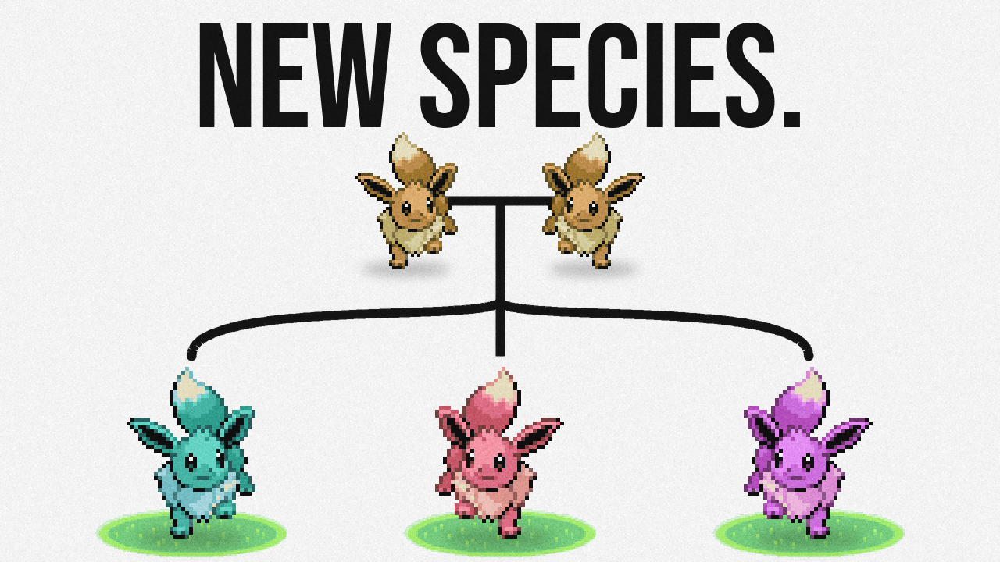
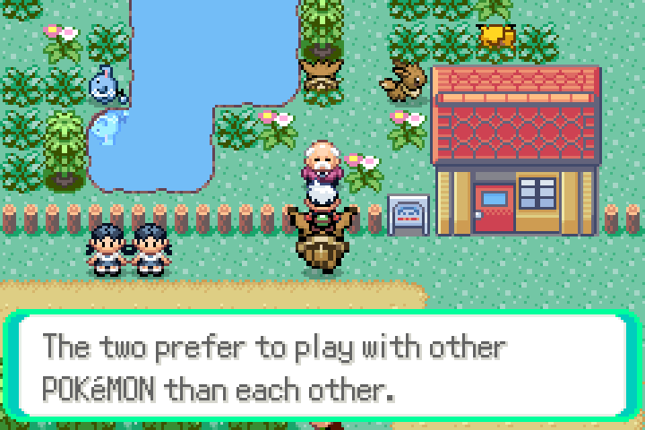
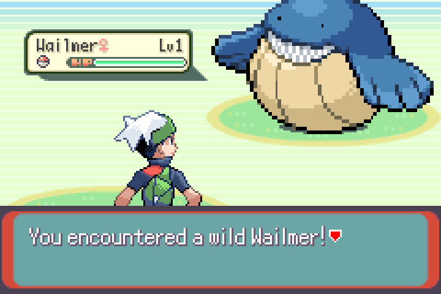
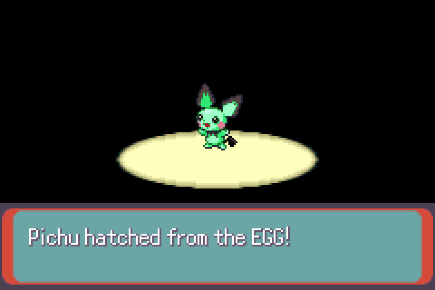
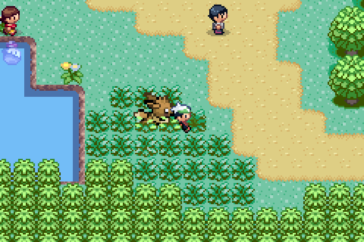

<p align="center">
  
</p>

<h1 align="center">Pokémon Emerald: Evolved</h1>

<p align="center">Pokémon Emerald, but Pokémon actually evolve. The real kind.</p>

<p align="center">
  <b><a href="https://github.com/IvanKuria/emerald-evolved/releases/latest">Download the patch</a></b> &nbsp;·&nbsp;
  <a href="#how-to-play">How to play</a> &nbsp;·&nbsp;
  <a href="#the-rules">The rules</a> &nbsp;·&nbsp;
  <a href="#building-from-source">Build it yourself</a>
</p>

So, this is the game from my video **I Gave Pokémon Real Evolution (And You Can Play It)**. Last time I gave Pokémon real genetics, and you guys left a ton of requests in the comments, so I built pretty much all of them into this one.

In the normal game, "evolution" is one Pokémon changing, which is honestly more like a caterpillar turning into a butterfly. Real evolution happens to a whole population over generations, and the biggest thing it does is make new species. So in this version every egg can mutate, colors and size are genes you can breed for, and if you keep breeding for it long enough your line turns into a brand new species that can't have babies with wild Pokémon anymore.

<p align="center">
  
  
  
  
  <br><sub>Straight from the game: a new species refusing a wild Eevee, a bred Wailmer at 1.92x size, a green Pichu hatching, and a bred line following you around Route 117.</sub>
</p>

It's built on [pokeemerald-expansion](https://github.com/rh-hideout/pokeemerald-expansion), the community's decompilation of Emerald. You get it as a `.bps` patch that goes on your own copy of the game. I don't give out ROMs, and there are no ROMs in this repo.

## How to play

**The easy way:** go to the website, drop in your own copy of Pokémon Emerald, and it checks it, patches it and starts the game right in your browser. Nothing gets uploaded, it all happens inside the tab, and it works on your phone too.

**The normal way:**
1. Get your own **Pokémon Emerald (USA, Europe)** ROM, dumped from your own cartridge. Its SHA-1 has to be `f3ae088181bf583e55daf962a92bb46f4f1d07b7`.
2. Download `emerald-evolved.bps` from the [releases page](https://github.com/IvanKuria/emerald-evolved/releases/latest).
3. Patch it with [Rom Patcher JS](https://www.marcrobledo.com/RomPatcher.js/) (works on phones too).
4. Play it in any GBA emulator. The patched game's SHA-1 should be `b833daac0573f700ec634b946cbdf55253739755`.

Start a new game. Saves from normal Emerald or from my Real Genetics mod won't work.

## The rules

- **Mutation.** Every time a Pokémon passes a gene to its egg there's a tiny chance it changes.
- **Shiny is a mutation now.** It's 1 in 16,384 for each parent, so about 1 in 8,192 per egg, the same odds as the real game. But it's an actual gene, so if you breed a shiny about half of its babies come out shiny too.
- **Color comes from both parents.** Every Pokémon has a color gene, one copy from mom and one from dad, and its color lands somewhere in between. About 1 in 12 eggs comes out a little shifted from its parents. It only moves the body colors, so every sprite still looks like a real sprite, and the genes stay with them when they evolve.
- **Size is genetic.** It shows up in battle (up to 2x) and on the summary screen, which now shows each Pokémon's height in meters.
- **Followers.** The first Pokémon in your party walks behind you in its own colors and size (capped at 1.5x so it doesn't cover you).
- **New species.** Some of the size genes don't work together with the old versions. If you keep breeding the biggest ones, the Day Care man starts saying the two "get along", then "don't seem to like each other much", and eventually "prefer to play with other POKéMON than each other." At that point your line can't have babies with wild ones anymore. For Eevee it took about 31 generations on average in my runs. It basically never happens by accident.
- **Some eggs don't hatch.** Breeding brothers and sisters brings out hidden broken genes, and an egg that gets a new gene without its partner won't make it either.
- **The summary screen** shows each Pokémon's generation in its trainer memo. Nicknames are capped at 10 characters to make room for it.

To be honest about it: in real life this takes thousands of years, so mutations here happen way faster, and the Day Care man is standing in for animals choosing who they pair with. The genes underneath work the way real ones do.

## What's different and known limitations

- The genes live in parts of the save the game doesn't use, so Tera, Dynamax and hyper training are switched off, and IVs come from genes (7 possible values per stat).
- The PC box can only show about 4 recolored Pokémon at once. The rest show their normal colors in the box, but they're still their real colors everywhere else.
- Contest and trade screens use the normal colors.

## Building from source

This repo is pokeemerald-expansion `1.17.2` with my changes on top (see the commit history). Set up the toolchain the way [pokeemerald-expansion](https://github.com/rh-hideout/pokeemerald-expansion) describes, then:

```
make            # builds the release ROM
make EVO_TEST=1 # builds the in-game test ROM
```

The release build should match the SHA-1 above byte for byte.

## Credits

- [pokeemerald-expansion](https://github.com/rh-hideout/pokeemerald-expansion) by RHH and everyone who works on it, built on [pret/pokeemerald](https://github.com/pret/pokeemerald).
- Everyone who left requests in the comments on the last video.

## Disclaimer

This is a free fan project and isn't affiliated with Nintendo, Creatures or GAME FREAK. Pokémon is © Nintendo / Creatures / GAME FREAK. No ROMs are included or distributed, you need your own copy of the game.
